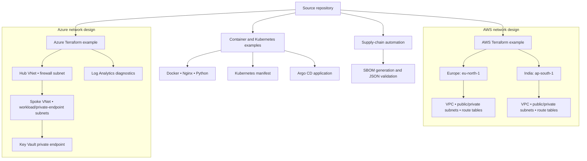

# Cloud & DevSecOps Engineering Lab

**Author:** Kunal Kashyap  
**Focus:** Cloud infrastructure, infrastructure as code, platform security, containerisation and software supply-chain practices.  
**Primary cloud regions in the current examples:** AWS Stockholm (`eu-north-1`), AWS Mumbai (`ap-south-1`) and Azure North Europe.

This repository is a practical engineering portfolio. It brings together infrastructure definitions, security-oriented configuration and automation experiments in one place. The goal is to make the design decisions visible and the work reviewable—not to present unverified infrastructure as a live production service.

> **Project status:** Active development. The files in this repository are implementation work and learning artefacts. A configuration being present does not mean it has been deployed, independently audited or proven production-ready. Check the code and validation results before using it.

---

## 1. What this repository covers

| Area | Current implementation in the repository |
|---|---|
| AWS infrastructure | Terraform configuration for separate Europe and India VPC environments, public/private subnets, route tables, internet gateways and security groups. |
| Azure network security | Terraform hub-and-spoke layout with VNet peering, subnets, NSGs, Azure Firewall policy and workload routing. |
| Identity and secrets | Azure managed identity, Key Vault, RBAC assignment and private-endpoint configuration. |
| Container workloads | Dockerfile, Python application, Nginx configuration and deployment helper under `docker-ha-cluster/`. |
| Kubernetes | Workload manifest under `kubernetes/`. |
| GitOps | Argo CD Application manifest in `argo-cd.yaml`. |
| AWS storage security | S3 bucket policy example covering transport security and encryption requirements. |
| Supply-chain security | SBOM generation helper under `supply-chain/`, using Syft and validating the generated JSON output. |
| Automation | Bash scripts and supporting operational modules. |

## 2. Architecture at a glance

The repository contains separate infrastructure examples. They are not presented as one already-connected, deployed multi-cloud environment.



## 3. Repository layout

```text
.
├── README.md
├── main.tf
├── variables.tf
├── outputs.tf
├── argo-cd.yaml
├── aws-cloud-security/
│   └── s3-bucket-policy.json
├── azure-zero-trust/
│   └── main.tf
├── docker-ha-cluster/
│   ├── Dockerfile
│   ├── app.py
│   ├── deploy.sh
│   └── nginx.conf
├── kubernetes/
│   └── production-manifest.yaml
├── supply-chain/
│   └── sbom-scan.sh
├── bash-automation/
├── network-diagnostics/
├── runtime-security/
└── zero-trust-vpc/
```

The directory listing reflects the current repository structure. Some modules are still being expanded; their presence should not be read as a claim that every module is complete.

## 4. Infrastructure design notes

### AWS — Europe and India

The root Terraform configuration defines two AWS provider aliases:

- **Europe:** `eu-north-1` (Stockholm), used for the primary VPC example.
- **India:** `ap-south-1` (Mumbai), used for the secondary VPC example.

Each VPC configuration includes public and private subnets across two availability zones, internet gateway routing for public subnets, dedicated private route tables and a security group with HTTPS ingress.

The Terraform backend block is configured for an S3 remote state bucket with encryption and native state locking (`use_lockfile = true`). The backend bucket must exist and be correctly secured before initialising with the remote backend. Do not put cloud credentials or state files in Git.

### Azure — North Europe

The `azure-zero-trust/` configuration describes a hub-and-spoke network design. The current code includes:

- Hub and spoke virtual networks with peering.
- Separate management, workload, firewall and private-endpoint subnets.
- Network security groups and a user-defined route for workload egress through the hub firewall.
- Azure Firewall and a firewall policy rule collection.
- A user-assigned managed identity and Key Vault with RBAC, soft-delete retention and purge protection.
- A Key Vault private endpoint and private DNS zone links.
- Log Analytics workspace and diagnostic settings.

These are configuration-level design elements. Validate provider compatibility, rule behaviour, routing and service dependencies in a controlled environment before any deployment.

## 5. Supply-chain workflow

The `supply-chain/sbom-scan.sh` helper is intended to generate an SPDX JSON software bill of materials for a container image.

Example:

```bash
chmod +x supply-chain/sbom-scan.sh
./supply-chain/sbom-scan.sh alpine:3.20
```

A different image can be supplied as the script argument:

```bash
./supply-chain/sbom-scan.sh nginx:1.27-alpine
```

Review the script and generated report before using the output in a release or compliance process. An SBOM is an inventory artefact; it does not by itself prove that an image is secure.

## 6. Local validation

Use a local Terraform installation and validate each Terraform root separately. These commands initialise providers without configuring the remote state backend:

```bash
# Root AWS configuration
terraform init -backend=false
terraform fmt -check
terraform validate

# Azure configuration
terraform -chdir=azure-zero-trust init -backend=false
terraform -chdir=azure-zero-trust fmt -check
terraform -chdir=azure-zero-trust validate
```

Validation may require provider downloads and a compatible Terraform version. The root AWS configuration declares Terraform `>= 1.11.0, < 2.0.0`; the Azure module declares its own version and provider constraints.

Before a real deployment:

1. Review the Terraform plan and every proposed resource change.
2. Configure credentials outside the repository using the cloud provider's supported authentication method.
3. Create and secure the remote-state bucket before enabling the S3 backend.
4. Review network exposure, firewall rules, IAM/RBAC permissions, costs and regional availability.
5. Deploy only in an account and environment where you have permission.

No cloud deployment, uptime target, compliance certification or successful pipeline run is claimed by this README.

## 7. Engineering principles

- **Least privilege:** keep identities and permissions scoped to the required resources.
- **Private by design:** use private subnets and private endpoints where the service architecture supports them.
- **Repeatability:** keep infrastructure and deployment configuration version-controlled.
- **Traceability:** produce reviewable configuration and software inventory artefacts.
- **Safe change management:** inspect plans, diffs and validation output before applying changes.
- **Honest status reporting:** distinguish code that exists, code that validates and infrastructure that has actually been deployed.

## 8. Current direction

The next engineering iterations are focused on improving module boundaries, adding repeatable validation, reviewing security controls, documenting operational assumptions and testing deployment paths safely. Planned work will be marked as planned until the corresponding code and evidence are present.

---

**Repository:** [cloud-devsecops-journey-2026](https://github.com/kunalnios44-ctrl/cloud-devsecops-journey-2026)  
**Source control:** GitHub  
**Status:** Work in progress
