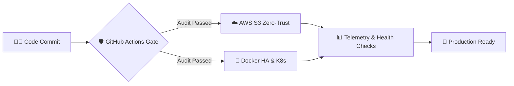

> [!IMPORTANT]
> # 🛡️ KUNAL KASHYAP
> ### **Cloud & DevSecOps Engineer | Zero-Trust Infrastructure & Automation**
> **🟢 CI/CD Pipeline:** `Enterprise DevSecOps Gate (Verified & Passing)`  
> **🌍 Target Regions:** 🇩🇰 **Denmark** • 🇸🇪 **Sweden** • 🇫🇮 **Finland** • 🇪🇺 **Europe** *(Open to Remote & Relocation)*  
> **📬 Direct Contact:** **kunalnios44@gmail.com** • **💻 GitHub:** **[://github.com](https://://github.com)**

---

## 🎯 Architecture Vision & Engineering Focus

This repository serves as a **production-grade blueprint** for modern **Cloud Infrastructure, High-Availability Containerization, and Automated DevSecOps**. Every module enforces **Zero-Trust principles, least-privilege IAM policies, and automated CI/CD compliance gates** before deployment.

---

## 🧩 Production Modules & Engineering Catalog

| Module / Directory | Core Focus | Key Engineering Capabilities |
| :--- | :--- | :--- |
| **`aws-cloud-security/`** | **Cloud Hardening** | Automated S3 bucket policy enforcement, mandatory `AES256` encryption, and strict `HTTPS/TLS` transport rules. |
| **`docker-ha-cluster/`** | **Container HA** | High-availability containerized service configurations designed for fault tolerance and zero-downtime scaling. |
| **`kubernetes/`** | **Orchestration** | Production-ready Kubernetes deployment manifests, service routing, and declarative cluster state management. |
| **`bash-automation/`** | **Ops Automation** | Modular shell scripting utilities for automated system reporting, log rotation, and server maintenance. |
| **`linux-health-check.sh`** | **System Telemetry** | Real-time CPU, memory, disk I/O, and critical process health diagnostics for Linux production nodes. |
| **`network-diagnostics.sh`** | **NetSec & Routing** | Automated DNS resolution, gateway latency, port availability, and SSL/TLS endpoint verification. |
| **`.github/workflows/`** | **Shift-Left CI/CD** | Continuous automated security gate (`devsecops-pipeline.yml`) verifying repository integrity on every push. |

---

## 🔄 End-to-End DevSecOps Lifecycle



---

## 🛠️ Technology Matrix

* **Operating Systems & Scripting:** `Linux (Ubuntu/RHEL)` • `Bash` • `Python`
* **Cloud & Identity Security:** `AWS (S3, IAM, Security Policies)` • `Microsoft Azure` • `Zero-Trust Architecture`
* **Containers & Orchestration:** `Docker` • `Docker Compose` • `Kubernetes` • `Helm`
* **Infrastructure as Code & GitOps:** `Terraform` • `Ansible` • `Argo CD`
* **CI/CD & Observability:** `Git` • `GitHub Actions` • `Prometheus` • `Grafana`

---

## 🛡️ Security & Compliance Standards Enforced

* **Encryption in Transit & At Rest:** All cloud storage policies explicitly deny unencrypted (`HTTP` or non-`AES256`) object uploads.
* **Automated Pre-Deployment Auditing:** Every commit triggers the **Enterprise DevSecOps Security Gate**, validating configurations and generating audit summaries.
* **Proactive Node Diagnostics:** Built-in telemetry scripts detect resource bottlenecks and network anomalies before service degradation occurs.

---

## ⚡ Quick Deployment & Audit Execution

```bash
# 1. Clone the repository
git clone https://://github.com/cloud-devsecops-journey-2026.git
cd cloud-devsecops-journey-2026

# 2. Configure executable permissions
chmod +x linux-health-check.sh network-diagnostics.sh aws-cloud-security/enforce-s3-security.sh

# 3. Run full infrastructure & security verification
./linux-health-check.sh
./network-diagnostics.sh
./aws-cloud-security/enforce-s3-security.sh
```
