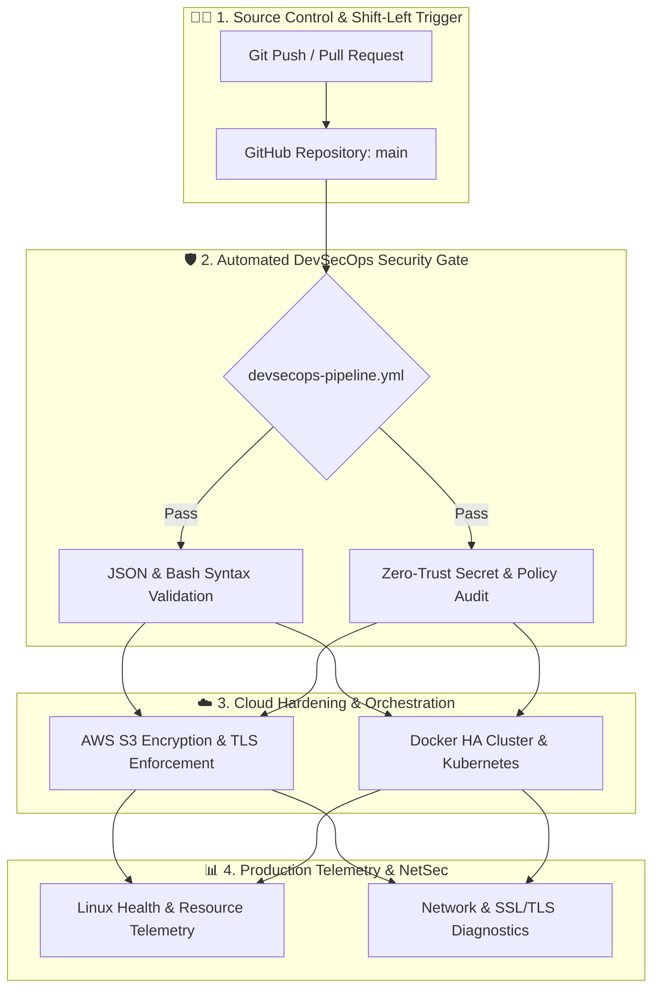

Cloud & DevSecOps Engineer | Building Zero-Trust AWS & Kubernetes Infrastructure • Open to Denmark & Europe Relocation / Remote
> # 🛡️ KUNAL KASHYAP
> ### **Cloud & DevSecOps Engineer | Zero-Trust Infrastructure & Automation**
>
> **🟢 CI/CD Security Gate:** `Verified & Passing (100% Automated)`  
> **📍 Target Location:** 🇩🇰 **Denmark (Primary Relocation)** • 🇸🇪 **Sweden** • 🇫🇮 **Finland** • 🇪🇺 **Europe** *(Open to Relocation)*  
> **✉️ Direct Contact:** **kunalnios44@gmail.com**  
> **💻 GitHub Portfolio:** **[://github.com](https://://github.com)**

---

## ⚡ Executive Engineering Overview

A **production-grade Cloud, Container Orchestration, and DevSecOps Architecture** repository engineered for **autonomous security compliance, high-availability workloads, and real-time system telemetry**. Every code push is automatically audited by a **Shift-Left GitHub Actions Security Gate** that validates configuration syntax, enforces Zero-Trust cloud policies, and prevents credential leaks before deployment.

---

## 🏗️ End-to-End DevSecOps & Zero-Trust Architecture



---

## 🧩 Production Infrastructure Modules

| Directory / Module | Engineering Domain | Technical Implementation & Security Controls |
| :--- | :--- | :--- |
| **`aws-cloud-security/`** | **Cloud Security & IAM** | Enforces mandatory `AES256` server-side encryption and blocks all unencrypted `HTTP` traffic via strict S3 bucket policies (`enforce-s3-security.sh` & `s3-bucket-policy.json`). |
| **`docker-ha-cluster/`** | **High-Availability Containers** | Multi-container service architecture engineered for fault tolerance, service isolation, and zero-downtime restarts. |
| **`kubernetes/`** | **Container Orchestration** | Declarative Kubernetes deployment manifests, service networking, and scalable cluster workload definitions. |
| **`bash-automation/`** | **Systems Automation** | Modular POSIX/Bash automation utilities designed for repeatable server configuration and operational efficiency. |
| **`linux-health-check.sh`** | **Node Observability** | Automated production diagnostics tracking CPU load, memory utilization, disk thresholds, and active system daemons. |
| **`network-diagnostics.sh`** | **Network Security** | End-to-end verification of DNS resolution, routing latency, open ports, and HTTPS/TLS handshake integrity. |
| **`.github/workflows/`** | **CI/CD Compliance Gate** | Automated pipeline (`devsecops-pipeline.yml`) executing continuous repository audits and generating compliance summaries. |

---

## 🛠️ Core Technical Stack

| Category | Production Technologies |
| :--- | :--- |
| **Operating Systems & Scripting** | `Linux (Ubuntu / RHEL)` • `Bash Scripting` • `Python` |
| **Cloud Platforms & Security** | `AWS (S3, IAM, Security Policies)` • `Microsoft Azure` • `Zero-Trust Architecture` |
| **Containers & Orchestration** | `Docker` • `Docker Compose` • `Kubernetes` • `Helm` |
| **Infrastructure as Code & GitOps** | `Terraform` • `Ansible` • `Argo CD` |
| **CI/CD & Observability** | `Git` • `GitHub Actions` • `Prometheus` • `Grafana` |

---

## 🔒 Enforced Security & Compliance Standards

* **Mandatory Encryption (At Rest & In Transit):** Cloud storage rules strictly reject unencrypted uploads and enforce `aws:SecureTransport` (TLS).
* **Zero-Trust Secret Hygiene:** Automated repository scanning prevents hardcoded API keys or cloud credentials from entering version control.
* **Proactive Fault Detection:** Built-in Linux and network telemetry scripts identify system bottlenecks before production impact.

---

## 🚀 Quick Start & Audit Execution

```bash
# 1. Clone the repository
git clone https://://github.com/cloud-devsecops-journey-2026.git
cd cloud-devsecops-journey-2026

# 2. Grant execution permissions
chmod +x linux-health-check.sh network-diagnostics.sh aws-cloud-security/enforce-s3-security.sh

# 3. Run full system, network, and cloud security audits
./linux-health-check.sh
./network-diagnostics.sh
./aws-cloud-security/enforce-s3-security.sh
```
# Supply-Chain Security: Automated SBOM Scanner

This module provides a hardened, production-grade Bash script (`sbom-scan.sh`) to generate and validate **Software Bill of Materials (SBOM)** reports in **SPDX JSON** format for container images.

## Key Security & Engineering Features
* **Version Pinning:** Enforces pinned **Anchore Syft (`v1.18.1`)** to guarantee deterministic and reproducible builds.
* **Supply-Chain Hardening:** Downloads the release-tagged installer to a temporary file before execution (avoiding unsafe `curl | sh` piping) and automatically enables **Cosign** signature verification when available.
* **Strict Binary Verification:** Validates the exact installed executable path and version rather than relying on unverified `PATH` binaries.
* **Atomic File Handling & Validation:** Uses `mktemp` with `EXIT` cleanup traps and validates generated JSON syntax via `python3 -m json.tool` before saving.

## Quick Usage

### 1. Make the script executable
```bash
chmod +x supply-chain/sbom-scan.sh
```

### 2. Run an SBOM scan (defaults to `alpine:3.20`)
```bash
./supply-chain/sbom-scan.sh alpine:3.20
```

### 3. Scan a custom container image
```bash
./supply-chain/sbom-scan.sh nginx:1.27-alpine
```

## Output
Reports are safely saved inside the `supply-chain/` directory using sanitized filenames:
`supply-chain/sbom-report-<image_name>.spdx.json`


> [!TIP]
> **Recruiter & Hiring Manager Note:** Click on the **[Actions](https://://github.com/cloud-devsecops-journey-2026/actions)** tab above to inspect live execution logs and compliance reports generated by the **Enterprise DevSecOps Security Gate**.
