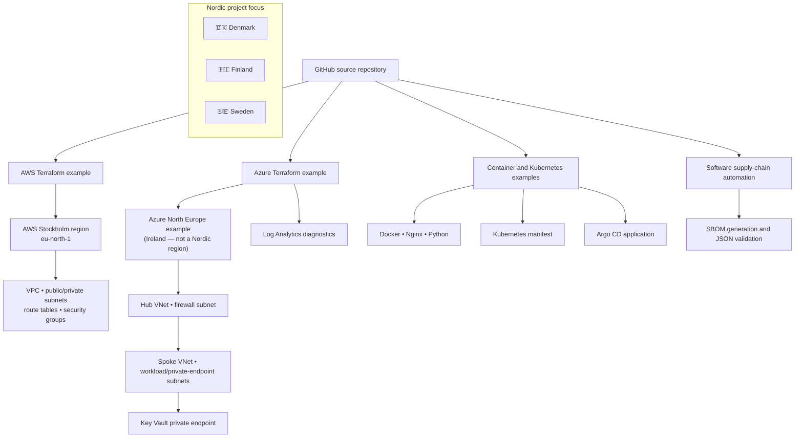

# Nordic Cloud & DevSecOps Engineering Lab 🇩🇰 🇫🇮 🇸🇪

**Author:** Kunal Kashyap  
**Project focus:** Cloud infrastructure, Infrastructure as Code, platform security, containerisation and software supply-chain engineering for **Denmark 🇩🇰, Finland 🇫🇮 and Sweden 🇸🇪**.

This repository is a practical engineering portfolio focused on Nordic cloud and platform-engineering scenarios. It contains infrastructure definitions, security-oriented configuration and automation experiments. The objective is to make the implementation and its design decisions reviewable—not to claim that an unverified environment is already running in production.

> **Project status:** Active development. Code in this repository is not automatically evidence of a successful deployment, independent security audit, compliance certification or production readiness. Validation results will be documented as they are produced.

---

## 1. Project scope

The target-country scope is intentionally limited to:

- 🇩🇰 **Denmark**
- 🇫🇮 **Finland**
- 🇸🇪 **Sweden**

The current AWS network example uses **Stockholm (eu-north-1)**, which is an AWS region in Sweden. The Azure example currently specifies **North Europe**; that Azure region is in Ireland, so it is documented as a European Azure example—not as a Denmark, Finland or Sweden region. Country targeting and cloud-region availability are separate decisions and must be checked against each provider's current regional catalogue.

## 2. What is currently in the repository

| Engineering area | Current repository material |
|---|---|
| AWS infrastructure | Terraform VPC, public/private subnet, route-table, internet-gateway and security-group configuration. |
| Azure network security | Terraform hub-and-spoke layout, VNet peering, NSGs, Azure Firewall policy and workload routing. |
| Identity and secrets | Azure managed identity, Key Vault, RBAC assignment and private-endpoint configuration. |
| Container workloads | Dockerfile, Python application, Nginx configuration and deployment helper under docker-ha-cluster/. |
| Kubernetes | Workload manifest under kubernetes/. |
| GitOps | Argo CD Application manifest in argo-cd.yaml. |
| AWS storage security | S3 bucket policy example for transport security and encryption requirements. |
| Supply-chain security | Syft SBOM generation in CI, plus a separate local SBOM helper under supply-chain/. |
| CI/CD | One root-level GitHub Actions workflow validates code and infrastructure, scans source and image, publishes the container to GHCR, and signs/verifies its digest. |
| Automation | Bash scripts, an S3 policy helper and runtime-security examples. |
| Python policy engine | Local-only JSON inventory evaluator under nexus-core/. |
| Go network diagnostics | Incomplete work in progress; not built, tested or included in the CI gate. |

## 3. Architecture overview

These are separate infrastructure examples in one portfolio repository. The diagram does not imply that the environments are already connected or deployed.



## 4. Repository layout

```text
.
├── README.md
├── main.tf
├── variables.tf
├── outputs.tf
├── argo-cd.yaml
├── aws-cloud-security/
│   ├── s3-bucket-policy.json
│   └── enforce-s3-security.sh
├── azure-zero-trust/
│   └── main.tf
├── docker-ha-cluster/
│   ├── Dockerfile
│   ├── app.py
│   ├── deploy.sh
│   └── nginx.conf
├── kubernetes/
│   └── demo-manifest.yaml
├── nexus-core/
│   ├── src/nexus_core/
│   └── tests/
├── supply-chain/
│   ├── sbom-scan.sh
├── bash-automation/scripts/
├── network-diagnostics/       # incomplete WIP; not CI-validated
├── runtime-security/
└── zero-trust-vpc/
```

Some modules are still being developed. A directory or configuration file being present does not mean its implementation is complete.

## 5. Infrastructure design notes

### AWS — Stockholm, Sweden 🇸🇪

The root Terraform configuration defaults to **Stockholm (eu-north-1)** and uses a configurable secondary AWS region (default **ap-south-1**) as a separate network example. The primary example defines public and private subnets across two discovered availability zones, internet-gateway routing for public subnets, dedicated private route tables and a security group with HTTPS ingress. Its outbound rule currently allows all IPv4 egress; it is not a strict zero-trust egress policy. The secondary VPC is only a network template—not a working disaster-recovery system, because replication, failover and recovery procedures are not implemented.

The Terraform backend block contains the explicit placeholder `REPLACE_WITH_EXISTING_TERRAFORM_STATE_BUCKET`, with encryption and native state locking (`use_lockfile = true`). Replace it with an existing secured bucket before using the remote backend. The CI workflow uses `init -backend=false` and does not access this bucket. Never commit cloud credentials or Terraform state files to Git.

### Azure — North Europe (Ireland)

The azure-zero-trust/ configuration currently specifies Azure's North Europe region. It is a European example in this repository, not a claim that the deployment is hosted in Denmark, Finland or Sweden.

The current code includes:

- Hub and spoke virtual networks with peering.
- Separate management, workload, firewall and private-endpoint subnets.
- Network security groups and a user-defined route for workload egress through the hub firewall.
- Azure Firewall and a firewall policy rule collection.
- A user-assigned managed identity and Key Vault with RBAC, soft-delete retention and purge protection.
- A Key Vault private endpoint and private DNS zone links.
- Log Analytics workspace and diagnostic settings.

Provider compatibility, network rules, routing, regional service availability and dependencies must be validated before deployment.

## 6. Software supply-chain workflow

The unified GitHub Actions workflow builds the Python demo image and generates an SPDX JSON SBOM with Syft. The SBOM is uploaded as a workflow artifact. The separate `supply-chain/sbom-scan.sh` helper can generate an SBOM locally for a supplied image.

Example:

```bash
chmod +x supply-chain/sbom-scan.sh
./supply-chain/sbom-scan.sh alpine:3.20
```

Another image can be supplied as the script argument:

```bash
./supply-chain/sbom-scan.sh nginxinc/nginx-unprivileged:1.27-alpine
```

Review the script and generated report before using the output in a release or compliance process. An SBOM is an inventory artefact; it does not by itself prove that an image is secure.

## 7. CI/CD validation

The active workflow is [Nordic Enterprise CI/CD](.github/workflows/ci-cd.yml). It is the only workflow directly under the repository's root `.github/workflows/` directory.

The workflow uses these 12 tools: Python, Ruff, Pytest, Terraform, Checkov, Gitleaks, ShellCheck, Trivy, Docker, Kubeconform, Syft and Cosign. GitHub Actions is the runner/orchestration platform and is not counted as one of the 12 tools.

On pushes and pull requests to `main`, CI runs Python lint/tests, Terraform formatting and validation for the root, Azure and zero-trust VPC configurations, Checkov, a current-working-tree Gitleaks scan, ShellCheck, Trivy filesystem and container-image scans, Docker build, Kubernetes schema validation and SBOM generation. The Gitleaks step uses `--no-git`, so it does not scan historical commits.

On a successful push to `main`, the release job publishes the application image to GitHub Container Registry and performs keyless Cosign signing plus signature verification. This is image publishing and signing—not deployment to AWS, Azure or a Kubernetes cluster.

The Kubernetes manifest is a separate unprivileged Nginx demo workload. It is not the Python image published by the release job. The Argo CD file is only a declarative Application configuration; no connected cluster or successful Argo CD sync is claimed.

## 8. Local validation

Validate each Terraform root separately. These commands initialise providers without configuring the remote state backend:

```bash
# Root AWS configuration
terraform init -backend=false
terraform fmt -check
terraform validate

# Azure configuration
terraform -chdir=azure-zero-trust init -backend=false
terraform -chdir=azure-zero-trust fmt -check
terraform -chdir=azure-zero-trust validate

# Additional AWS zero-trust VPC example
terraform -chdir=zero-trust-vpc init -backend=false
terraform -chdir=zero-trust-vpc fmt -check
terraform -chdir=zero-trust-vpc validate
```

Validation may require provider downloads and a compatible Terraform version. The root AWS configuration declares Terraform >= 1.11.0, < 2.0.0; the Azure module declares its own version and provider constraints.

Before any real deployment:

1. Review the Terraform plan and every proposed resource change.
2. Configure credentials outside the repository using the cloud provider's supported authentication method.
3. Create and secure the remote-state bucket before enabling the S3 backend.
4. Review network exposure, firewall rules, IAM/RBAC permissions, costs and regional availability.
5. Deploy only in an account and environment where you have permission.

This README does not claim a successful cloud deployment, uptime target, compliance certification or passing pipeline unless supporting evidence is committed.

## 9. Engineering principles

- **Least privilege:** scope identities and permissions to the resources that need them.
- **Private by design:** use private subnets and private endpoints where the architecture supports them.
- **Repeatability:** keep infrastructure and deployment configuration version-controlled.
- **Traceability:** produce reviewable configuration and software inventory artefacts.
- **Safe change management:** inspect plans, diffs and validation output before applying changes.
- **Honest status reporting:** distinguish code that exists, code that validates and infrastructure that has actually been deployed.

## 10. Next engineering direction

The next iterations will focus on modular Terraform, repeatable CI validation, security-control testing, operational documentation and region-aware design for Denmark 🇩🇰, Finland 🇫🇮 and Sweden 🇸🇪. Country-specific cloud placement will only be claimed when the chosen provider actually offers the required service in that region.

---

**Repository:** [cloud-devsecops-journey-2026](https://github.com/kunalnios44-ctrl/cloud-devsecops-journey-2026)  
**Source control:** GitHub  
**Status:** Work in progress


## NORDIC NEXUS Core

The repository includes an initial, local-only policy evaluation engine under [`nexus-core/`](nexus-core/README.md). It evaluates normalized JSON inventory records for encryption-at-rest, public accessibility and owner metadata. Ruff and Pytest are run by the unified NORDIC NEXUS workflow.

This is an early engineering foundation—not a live cloud scanner, production deployment or compliance certification. See [NORDIC NEXUS Core documentation](nexus-core/README.md) for setup, limitations and roadmap.
